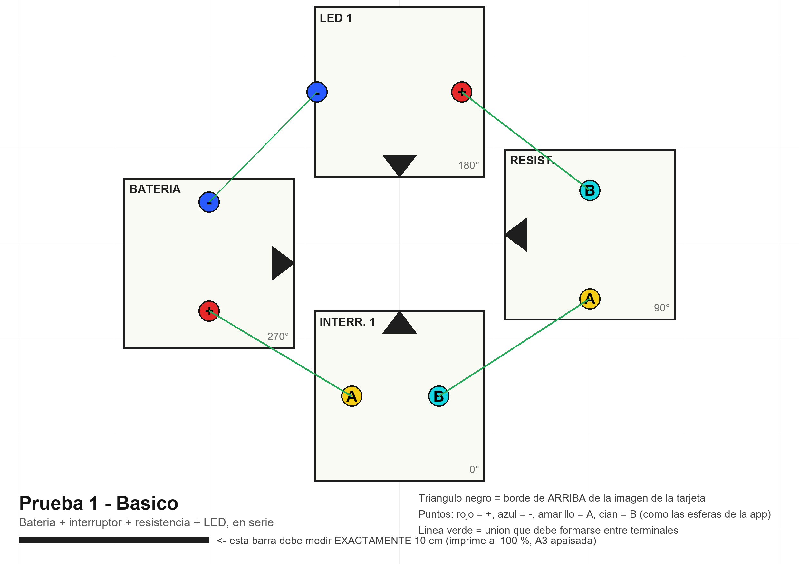
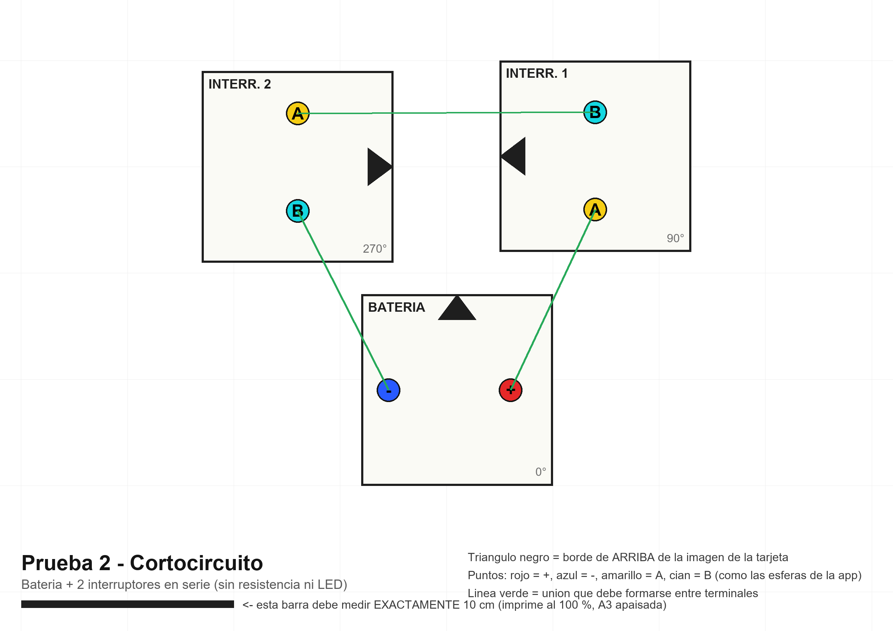
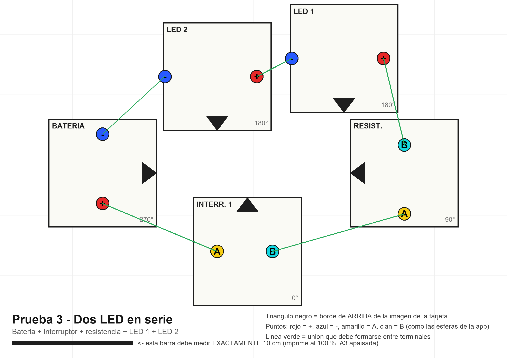
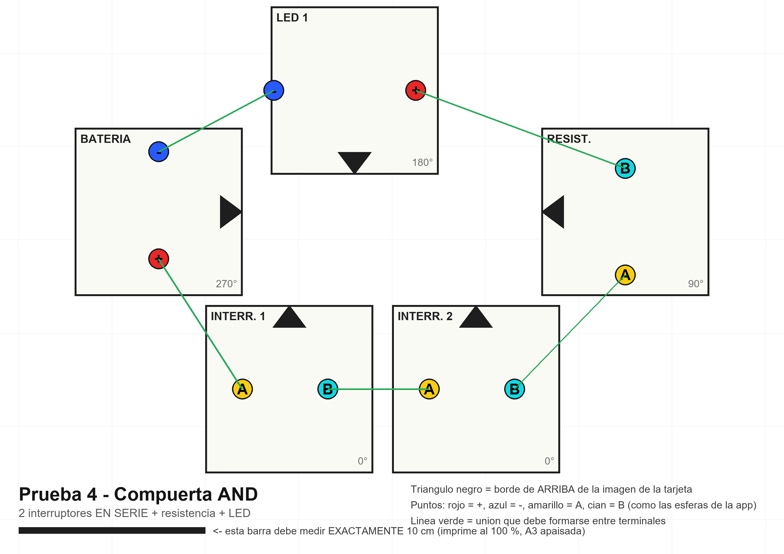
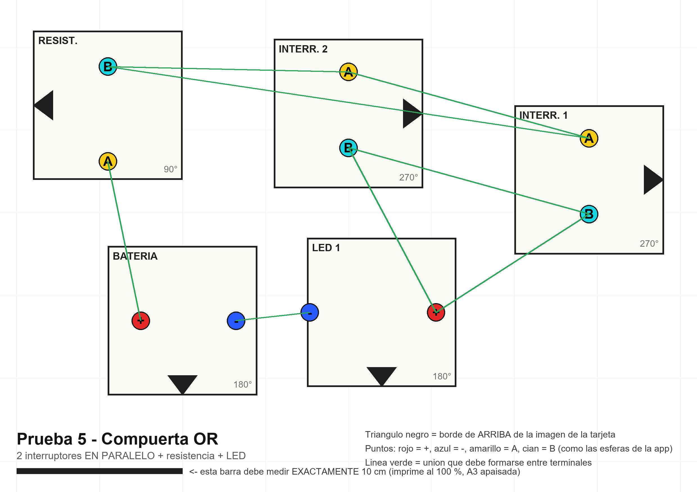
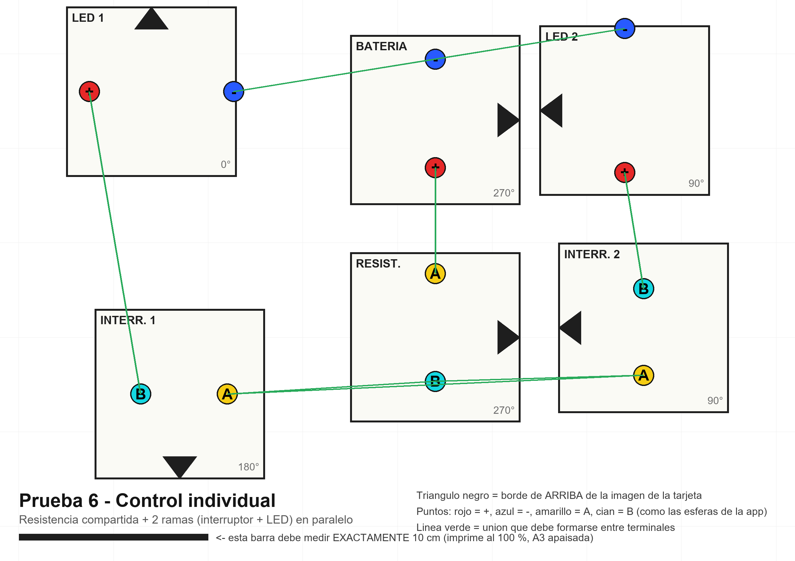

# Guía de pruebas del simulador AR de circuitos

Seis pruebas con las tarjetas que ya tienes (1 batería, 1 resistencia, 2 interruptores, 2 LED). Cada una indica **dónde poner cada tarjeta**, **qué voltaje y qué resistencia usar** y **qué debe pasar en la app**.

> Los números salen del mismo cálculo que usa la app (Ley de Ohm: batería con 1 ohm interno, LED con 2 V de umbral y 10 ohm). Las posiciones salen de una simulación de la regla de conexión de la app, probada con errores de colocación aleatorios.

---

## 0. Antes de empezar

### Imprime las plantillas
- Archivo: [`plantillas/Plantillas_A3.pdf`](plantillas/Plantillas_A3.pdf) (una hoja por prueba) o las imágenes de la carpeta `plantillas/`.
- **Hoja A3 apaisada, al 100 % de escala** ("tamaño real", nunca "ajustar a página"). Comprueba con una regla que la barra negra de abajo mida **exactamente 10 cm**.
- Pon cada tarjeta **sobre su cuadro**. El **triángulo negro** marca el borde de **arriba de la imagen de la tarjeta** (el borde superior del archivo PNG que imprimiste). Gira la tarjeta hasta que su borde de arriba coincida con el triángulo.
- Los puntos de colores son los terminales y coinciden con las esferas que dibuja la app: **rojo = +, azul = −, amarillo = A, cian = B**. Cuando dos terminales se unen, sus esferas se ponen **verdes**.

### Por qué conviene la plantilla
| Cómo colocas las tarjetas | Circuitos en serie (1, 3, 4) | Paralelo (5, 6) |
|---|---|---|
| Sobre la plantilla (error ≤ 0,5 cm y ≤ 4°) | 100 % | 99-100 % |
| A ojo, con cuidado (≤ 1 cm y ≤ 7°) | 100 % | ~70 % |
| A ojo, sin cuidado (≤ 1,5 cm y ≤ 10°) | 91-99 % | ~30 % |

Los circuitos en serie perdonan casi todo. **Los de paralelo (OR y control individual) solo funcionan de forma fiable con la plantilla**, porque en el punto donde se juntan tres terminales las distancias deben ser casi iguales.

### Dos avisos sobre tus tarjetas actuales
1. En la base de datos de Vuforia, `marcador_led` mide **9 × 17,7 cm** y `marcador_bateria` **9 × 13,4 cm** (no son cuadradas). Las plantillas suponen tarjetas **cuadradas de 9 × 9 cm**. Si las imprimiste con esa proporción larga, se reconocen peor y se solapan en la plantilla. Usa tarjetas de 9 × 9, o rehaz esas dos imágenes.
2. En las pruebas, **"LED"** es la tarjeta `LED` y **"LED 2"** la tarjeta `LED 2`; **"Interruptor"** e **"Interruptor 2"** igual.

### Cómo cambiar valores en la app
- **Tocar cerca de la resistencia** → pasa al siguiente valor: 100 → 220 → 330 → 470 → 1 k → 2,2 k → 4,7 k → 10 k → (vuelve a 100).
  ⚠️ Pasar de 10 k a **100 ohm con 9 V quema el LED** (63 mA).
- **Tocar cerca de la batería** → 3 → 5 → 9 → 12 → 3 V.
- **Tocar el interruptor** → abre o cierra.
- **LED quemado**: retira su tarjeta y vuélvela a poner.

### Tabla maestra: ¿qué pasa con cada resistencia y voltaje? (1 LED en serie)
Corriente y brillo del LED. "Aviso" = más de 35 mA; "se quema" = más de 50 mA.

| Resistencia | 3 V | 5 V | 9 V | 12 V |
|---|---|---|---|---|
| 100 ohm | 9,0 mA, 45 % | 27,0 mA, 100 % | **SE QUEMA** (63 mA) | **SE QUEMA** (90 mA) |
| 220 ohm | 4,3 mA, 22 % | 13,0 mA, 65 % | 30,3 mA, 100 % | 43,3 mA, 100 % (aviso) |
| 330 ohm | 2,9 mA, 15 % | 8,8 mA, 44 % | 20,5 mA, 100 % | 29,3 mA, 100 % |
| **470 ohm** | 2,1 mA, 12 % | 6,2 mA, 31 % | **14,6 mA, 73 %** | 20,8 mA, 100 % |
| 1 k ohm | 1,0 mA, 12 % | 3,0 mA, 15 % | 6,9 mA, 35 % | 9,9 mA, 49 % |
| 2,2 k ohm | 0,5 mA, 12 % | 1,4 mA, 12 % | 3,2 mA, 16 % | 4,5 mA, 23 % |
| 4,7 k ohm | apagado | 0,6 mA, 12 % | 1,5 mA, 12 % | 2,1 mA, 12 % |
| 10 k ohm | apagado | apagado | 0,7 mA, 12 % | 1,0 mA, 12 % |

Fórmula: I = (V − 2 V) / (1 + R + 10 ohm). Si "apagado" con el circuito cerrado, la app avisa que casi no pasa corriente.

---

## Prueba 1 — Básico (4 tarjetas)

**Objetivo:** el circuito más simple que cierra. Retos relacionados: 1, 2, 3, 4.

| Tarjeta | Centro (cm) | Giro | Terminales |
|---|---|---|---|
| Batería | (−10,0 ; −1,0) | tope de la imagen → derecha | + abajo, − arriba |
| Interruptor | (0,0 ; −8,0) | tope → arriba | A izquierda, B derecha |
| Resistencia | (10,0 ; 0,5) | tope → izquierda | A abajo, B arriba |
| LED | (0,0 ; 8,0) | tope → abajo | + derecha, − izquierda |

(Origen en el centro de la hoja, X a la derecha, Y hacia arriba.)

**Valores recomendados:** **9 V y 470 ohm** → 14,6 mA, LED al 73 %.

**Pasos y resultado:**
1. Coloca las 4 tarjetas. Las 8 esferas de los terminales unidos deben ponerse verdes.
2. Con el interruptor cerrado: mensaje *"Circuito cerrado… I = 14,6 mA · 6,8 V = 470 ohm × 14,6 mA · LED 2,0 V"*, cables **verdes** con pulsos en movimiento, LED encendido.
3. Toca el interruptor: *"Circuito abierto"*, cables naranja, LED apagado.
4. Toca cerca de la resistencia varias veces y compara con la tabla maestra.

**Variantes:**
- **LED al revés:** gira solo la tarjeta del LED 180° → *"polaridad invertida"*, cables rojos, el LED no enciende ni se quema (reto 6).
- **Quemar un LED a propósito:** con 9 V, pasa la resistencia a **100 ohm** → se quema, sale humo y suena un zap (reto 7). Retira la tarjeta del LED y vuélvela a poner con 470 ohm.

---

## Prueba 2 — Cortocircuito (3 tarjetas)

**Objetivo:** ver qué pasa sin nada que limite la corriente. Dos interruptores cerrados en serie hacen de cable. Reto 5.

| Tarjeta | Centro (cm) | Giro | Terminales |
|---|---|---|---|
| Batería | (0,5 ; −5,5) | tope → arriba | + derecha, − izquierda |
| Interruptor | (7,0 ; 5,5) | tope → izquierda | A abajo, B arriba |
| Interruptor 2 | (−7,0 ; 5,0) | tope → derecha | A arriba, B abajo |

**Valores:** no hay resistencia. Corriente con los dos interruptores cerrados: **3 V → 2,9 A · 5 V → 4,9 A · 9 V → 8,8 A · 12 V → 11,8 A**.

**Resultado:** con los dos cerrados → *"¡Cortocircuito!… Corriente: 8,8 A (¡demasiada!)"*, cables **rojos**, chispas y zap. Abre uno → *"Circuito abierto"*.

*(Con 2 tarjetas no es posible: los terminales de la batería y del interruptor quedarían a distancias casi iguales y se mezclarían.)*

---

## Prueba 3 — Dos LED en serie (5 tarjetas)

**Objetivo:** los dos LED comparten la misma corriente. Reto 8.

| Tarjeta | Centro (cm) | Giro | Terminales |
|---|---|---|---|
| Batería | (−12,5 ; −1,5) | tope → derecha | + abajo, − arriba |
| Interruptor | (−0,5 ; −8,0) | tope → arriba | A izquierda, B derecha |
| Resistencia | (12,5 ; −1,5) | tope → izquierda | A abajo, B arriba |
| LED | (7,5 ; 8,0) | tope → abajo | + derecha, − izquierda |
| LED 2 | (−3,0 ; 6,5) | tope → abajo | + derecha, − izquierda |

**Valores recomendados:** **9 V y 330 ohm** → 14,2 mA, cada LED al 71 %.

| Voltaje | Resistencia | Corriente | Resultado |
|---|---|---|---|
| 9 V | 470 ohm | 10,2 mA | 51 % cada uno |
| **9 V** | **330 ohm** | **14,2 mA** | **71 % cada uno** |
| 9 V | 220 ohm | 20,7 mA | 100 % cada uno |
| 9 V | 100 ohm | 41,3 mA | 100 % con aviso (límite) |
| 12 V | 470 ohm | 16,3 mA | 81 % |
| 5 V | 100 ohm | 8,3 mA | 41 % |
| **3 V** | cualquiera | **0 mA** | **no encienden**: 2 LED necesitan más de 4 V |

Con 3 V, el mensaje es *"Circuito cerrado, pero casi no pasa corriente: el voltaje no alcanza…"*. Es una buena demostración de por qué se suman las caídas en serie.

---

## Prueba 4 — Compuerta AND (5 tarjetas)

**Objetivo:** dos interruptores **en serie**: el LED enciende solo si **ambos** están cerrados. Reto 9.

| Tarjeta | Centro (cm) | Giro | Terminales |
|---|---|---|---|
| Batería | (−12,5 ; 1,5) | tope → derecha | + abajo, − arriba |
| Interruptor | (−5,5 ; −8,0) | tope → arriba | A izquierda, B derecha |
| Interruptor 2 | (4,5 ; −8,0) | tope → arriba | A izquierda, B derecha |
| Resistencia | (12,5 ; 1,5) | tope → izquierda | A abajo, B arriba |
| LED | (−2,0 ; 8,0) | tope → abajo | + derecha, − izquierda |

**Valores:** **9 V y 470 ohm** (14,6 mA, 73 %).

| Interruptor | Interruptor 2 | LED |
|---|---|---|
| abierto | abierto | apagado |
| abierto | cerrado | apagado |
| cerrado | abierto | apagado |
| cerrado | cerrado | **enciende (14,6 mA)** |

Toca los interruptores para recorrer las 4 filas; el reto 9 te muestra cuáles ya probaste.

---

## Prueba 5 — Compuerta OR (5 tarjetas, **paralelo**)

**Objetivo:** dos interruptores **en paralelo**: el LED enciende si **al menos uno** está cerrado. Reto 10.
**Usa la plantilla**: aquí tres terminales se juntan en cada punto de unión.

| Tarjeta | Centro (cm) | Giro | Terminales |
|---|---|---|---|
| Batería | (−10,0 ; −6,5) | tope → abajo | + izquierda, − derecha |
| Resistencia | (−14,5 ; 6,5) | tope → izquierda | A abajo, B arriba |
| Interruptor | (14,5 ; 2,0) | tope → derecha | A arriba, B abajo |
| Interruptor 2 | (0,0 ; 6,0) | tope → derecha | A arriba, B abajo |
| LED | (2,0 ; −6,0) | tope → abajo | + derecha, − izquierda |

**Valores:** **9 V y 470 ohm** (14,6 mA, 73 %).

| Interruptor | Interruptor 2 | LED |
|---|---|---|
| abierto | abierto | apagado |
| abierto | cerrado | **enciende** |
| cerrado | abierto | **enciende** |
| cerrado | cerrado | **enciende** |

---

## Prueba 6 — Control individual (6 tarjetas, **paralelo**)

**Objetivo:** una resistencia compartida y dos ramas en paralelo, cada una con su interruptor y su LED. Reto 11.
**Usa la plantilla.**

| Tarjeta | Centro (cm) | Giro | Terminales |
|---|---|---|---|
| Batería | (2,0 ; 6,5) | tope → derecha | + abajo, − arriba |
| Resistencia | (2,0 ; −5,0) | tope → derecha | A arriba, B abajo |
| Interruptor | (−11,5 ; −8,0) | tope → abajo | A derecha, B izquierda |
| Interruptor 2 | (13,0 ; −4,5) | tope → izquierda | A abajo, B arriba |
| LED | (−13,0 ; 8,0) | tope → arriba | + izquierda, − derecha |
| LED 2 | (12,0 ; 7,0) | tope → izquierda | + abajo, − arriba |

**Valores recomendados:** **9 V y 330 ohm compartida.**

| Interruptores | LED | LED 2 | Corriente de la batería |
|---|---|---|---|
| ninguno cerrado | apagado | apagado | 0 |
| solo Interruptor | **20,5 mA, 100 %** | apagado | 20,5 mA |
| solo Interruptor 2 | apagado | **20,5 mA, 100 %** | 20,5 mA |
| los dos cerrados | 10,4 mA, 52 % | 10,4 mA, 52 % | 20,8 mA |

**Lo que enseña:** con una sola rama cerrada el LED brilla al 100 %, pero al cerrar también la otra la corriente **se reparte** y cada LED baja a la mitad (la resistencia compartida limita el total).

| Voltaje | R compartida | Solo 1 rama | Las 2 ramas (cada LED) |
|---|---|---|---|
| 9 V | 470 ohm | 14,6 mA (73 %) | 7,4 mA (37 %) |
| **9 V** | **330 ohm** | **20,5 mA (100 %)** | **10,4 mA (52 %)** |
| 9 V | 220 ohm | 30,3 mA (100 %) | 15,5 mA (77 %) |
| 12 V | 1 k ohm | 9,9 mA (49 %) | 5,0 mA (25 %) |
| 5 V | 100 ohm | 27,0 mA (100 %) | 14,2 mA (71 %) |

---

## Cuando algo no funciona

| Qué ves | Causa probable |
|---|---|
| Las esferas no se ponen verdes | Una tarjeta está fuera de su cuadro o girada mal (mira el triángulo). Revisa la regla de 10 cm de la plantilla. |
| Una esfera se pone verde donde no debía | Dos tarjetas están muy cerca de un terminal ajeno: sepáralas al menos 0,5 cm. |
| Se une la mitad del circuito | Una tarjeta no se reconoce: mejora la luz, el papel mate y que sea cuadrada de 9 × 9 cm. |
| *"Circuito abierto"* con todo verde | Un interruptor está abierto (tócalo). |
| Los LED no encienden con el circuito cerrado | Mira la tabla maestra: voltaje bajo o resistencia muy grande. |
| En paralelo se une todo menos un terminal | Usa la plantilla; a ojo el paralelo falla ~70 % de las veces. |
